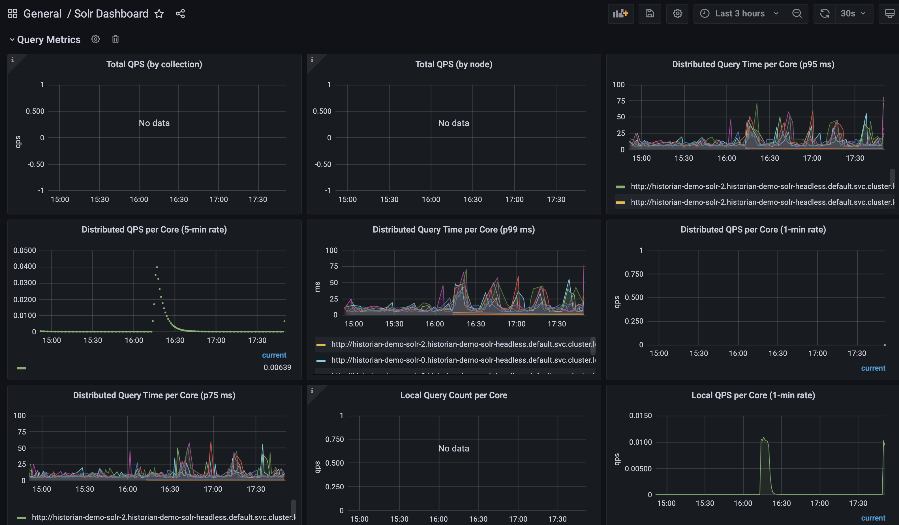
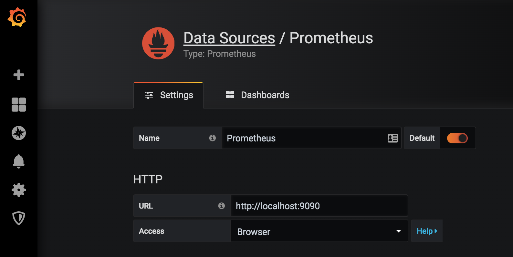
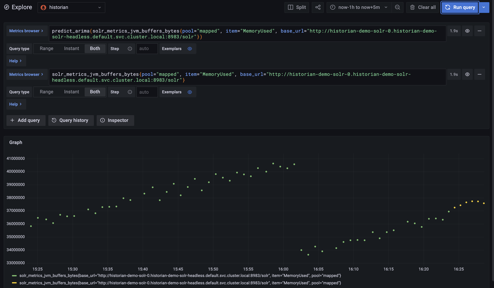

[Grafana](http://grafana.com/) supports querying Historian through Prometheus datasource.
The Grafana data source for Prometheus is included since Grafana 2.5.0 (2015-10-28). 

> You don't have anything to do to work with Historian because the PromQL language and REST API of Historian are compatible.

The following shows an example Grafana dashboard which queries Prometheus for data:



### Installing

To install Grafana see the [official Grafana
documentation](https://grafana.com/grafana/download/).

### Using

By default, Grafana will be listening on
[http://localhost:3000](http://localhost:3000). The default login is "admin" /
"admin".

### Creating a Prometheus data source

To create a Prometheus data source in Grafana:

1. Click on the "cogwheel" in the sidebar to open the Configuration menu.
2. Click on "Data Sources".
3. Click on "Add data source".
4. Select "Prometheus" as the type.
5. Set the appropriate Prometheus server URL (for example, `http://localhost:9090/`)
6. Adjust other data source settings as desired (for example, choosing the right Access method).
7. Click "Save & Test" to save the new data source.

The following shows an example data source configuration:



### Creating a Prometheus graph

Follow the standard way of adding a new Grafana graph. Then:

1. Click the graph title, then click "Edit".
2. Under the "Metrics" tab, select your Prometheus data source (bottom right).
3. Enter any Prometheus expression into the "Query" field, while using the
   "Metric" field to lookup metrics via autocompletion.
4. To format the legend names of time series, use the "Legend format" input. For
   example, to show only the `method` and `status` labels of a returned query
   result, separated by a dash, you could use the legend format string
   `{{method}} - {{status}}`.
5. Tune other graph settings until you have a working graph.

The following shows an example Prometheus graph configuration:


In Grafana 7.2 and later, the `$__rate_interval` variable is
[recommended](https://grafana.com/docs/grafana/latest/datasources/prometheus/#using-__rate_interval)
for use in the `rate`and `increase` functions.

### Importing pre-built dashboards from Grafana.com

Grafana.com maintains [a collection of shared dashboards](https://grafana.com/dashboards)
which can be downloaded and used with standalone instances of Grafana.  Use
the Grafana.com "Filter" option to browse dashboards for the "Prometheus"
data source only.

You must currently manually edit the downloaded JSON files and correct the
`datasource:` entries to reflect the Grafana data source name which you
chose for your Prometheus server.  Use the "Dashboards" → "Home" → "Import"
option to import the edited dashboard file into your Grafana install.

# Monitoring Historian via Solr with Prometheus and Grafana
If you use Prometheus and Grafana for metrics storage and data visualization, Solr provides 2 solutions to collect metrics and other data:

 - Prometheus Exporter
 - Metrics API with Prometheus format

   
The Prometheus exporter is included with the full Solr distribution, and is located under ` prometheus-exporter `/. It is not included in the `slim` Solr distribution.
A Prometheus exporter (`solr-exporter`) allows users to monitor not only Solr metrics which come from the [Metrics API](https://solr.apache.org/guide/solr/latest/deployment-guide/metrics-reporting.html#metrics-api), but also facet counts which come from [Faceting](https://solr.apache.org/guide/solr/latest/query-guide/faceting.html) and responses to [Collections API](https://solr.apache.org/guide/solr/latest/configuration-guide/collections-api.html) commands and [Ping](https://solr.apache.org/guide/solr/latest/deployment-guide/ping.html) requests.

The Metrics API provides a Prometheus Response Writer to output Solr metrics natively to be scraped. It is more efficient and drops the need of running the Prometheus Exporter but at the cost of a fixed output and is not as flexible in terms of configurability. See [Metrics API](https://solr.apache.org/guide/solr/latest/deployment-guide/monitoring-with-prometheus-and-grafana.html) for details.


## Prometheus Exporter

There are three aspects to running solr-exporter:

 - Modify the `solr-exporter-config.xml` to define the data to collect. Solr has a default configuration you can use, but if you would like to you can modify it before running the exporter the first time.

 - Start the exporter from within Solr.

 - Modify your Prometheus configuration to listen on the correct port.

## Starting the server

You can start `solr-exporter` by running `./bin/solr-exporter` (Linux) or `.\bin\solr-exporter.cmd` (Windows) from the `prometheus-exporter/` directory.
The metrics exposed by `solr-exporter` can be seen at the metrics endpoint: http://localhost:8983/solr/admin/metrics.

See the commands below depending on your operating system and Solr operating mode: Only Linux is shown here.

### Linux


**User-managed / Single-node**

```bash
# cd prometheus-exporter

# ./bin/solr-exporter -p 9854 -b http://localhost:8983/solr  --config-file ./conf/solr-exporter-config.xml  --num-threads 8
```
**SolrCloud**

```bash
# cd prometheus-exporter

# ./bin/solr-exporter -p 9854 -z http://localhost:2181/solr --config-file ./conf/solr-exporter-config.xml --num-threads 16
```

## Prometheus Configuration


Prometheus is a separate server that you need to download and deploy. More information can be found at the Prometheus [Getting Started](https://prometheus.io/docs/prometheus/latest/getting_started/) page.
In order for Prometheus to know about the `solr-exporter`, the listen address must be added to the Prometheus server’s `prometheus.yml` configuration file, as in this example:

```bash
   scrape_configs:
     - job_name: 'solr'  
       static_configs:
         - targets: ['localhost:9854']
```

If you already have a section for `scrape_configs`, you can add the `job_name` and other values in the same section.

When you apply the settings to Prometheus, it will start to pull Solr’s metrics from `solr-exporter`.

You can test that the Prometheus server, `solr-exporter`, and Solr are working together by browsing to http://localhost:9090  and doing a query for `solr_ping` metric in the Prometheus GUI.

## Sample Grafana Dashboard

A Grafana sample dashboard is provided in the following JSON file: `prometheus-exporter/conf/grafana-solr-dashboard.json`. You can place this with your other Grafana dashboard configurations and modify it as necessary depending on any customization you’ve done for the `solr-exporter` configuration.

You can directly import the Solr dashboard [via grafana.com](https://grafana.com/grafana/dashboards/12456-solr-dashboard/) by using the Import function with the dashboard id 12456. 


***

***

***

# An Implimentation

In this tutorial we will give a practical example of running the `solr-exporter` in a SolrCloud cluster.  
We will use a three node SolrCloud cluster with a Historian Collection and a Zookeeper ensemble (of three) and pull metrics from `solr-exporter` using Prometheus. Finally we will visualize the operating system and network metrics pulled by Prometheus, listening on http://localhost:9090 and the `solr-exporter` metrics listening on http://localhost:9854 , via Grafana using some prebuilt dashboards. The three cluster nodes have the following hostnames and IP addresses: hdpv1: 192.168.1.40, hdpv2:192.168.1.41, hdpv3:192.168.1.42.

## Zookeeper

Start a Zookeeper service on each of the three nodes.

```bash
# cd /opt/zookeeper/apache-zookeeper-3.8.4-bin
[root@hdpv1 apache-zookeeper-3.8.4-bin]#  bin/zkServer.sh start-foreground
[root@hdpv2 apache-zookeeper-3.8.4-bin]#  bin/zkServer.sh start-foreground
[root@hdpv3 apache-zookeeper-3.8.4-bin]#  bin/zkServer.sh start-foreground
```

Wait for a quorom to be reached then check for status

```bash
[root@hdpv1 apache-zookeeper-3.8.4-bin]# bin/zkServer.sh status
ZooKeeper JMX enabled by default
Using config: /opt/zookeeper/apache-zookeeper-3.8.4-bin/bin/../conf/zoo.cfg
Client port found: 2181. Client address: localhost. Client SSL: false.
Mode: leader
[root@hdpv2 apache-zookeeper-3.8.4-bin]# bin/zkServer.sh status
ZooKeeper JMX enabled by default
Using config: /opt/zookeeper/apache-zookeeper-3.8.4-bin/bin/../conf/zoo.cfg
Client port found: 2181. Client address: localhost. Client SSL: false.
Mode: follower
[root@hdpv3 apache-zookeeper-3.8.4-bin]# bin/zkServer.sh status
ZooKeeper JMX enabled by default
Using config: /opt/zookeeper/apache-zookeeper-3.8.4-bin/bin/../conf/zoo.cfg
Client port found: 2181. Client address: localhost. Client SSL: false.
Mode: follower
```

## Solr

Next start Solr on each of the three nodes.

```bash
# cd /opt/solr/solr-8.11.4
[root@hdpv1 solr-8.11.4]# bin/solr start -force -c -s /opt/solr/solr-8.11.4/data/historian -p 8983 -z 192.168.1.40:2181,192.168.1.41:2181,192.168.1.42:2181
[root@hdpv2 solr-8.11.4]# bin/solr start -force -c -s /opt/solr/solr-8.11.4/data/historian -p 8983 -z 192.168.1.40:2181,192.168.1.41:2181,192.168.1.42:2181
[root@hdpv3 solr-8.11.4]# bin/solr start -force -c -s /opt/solr/solr-8.11.4/data/historian -p 8983 -z 192.168.1.40:2181,192.168.1.41:2181,192.168.1.42:2181

# Waiting up to 180 seconds to see Solr running on port 8983 [|]  
# Started Solr server on port 8983 (pid=10415). Happy searching!
```

Go to the web browser on http://localhost:8983 and connect to Solr.


Here is a screenshot of SolrCloud in graph mode.


Here is a screenshot of SolrCloud monitoring the Zookeeper ensemble.


Here is a screenshot of SolrCloud monitoring the cluster nodes.


## Historian

Next start Historian on one or all three nodes.

```bash

#  cd /opt/historian/historian-1.3.9/
[root@hdpv1 historian-1.3.9]# java -jar /opt/historian/historian-1.3.9/lib/historian-server-1.3.9-fat.jar  -conf /opt/historian/historian-1.3.9/conf/historian-server-conf.json

# [vert.x-eventloop-thread-0] INFO  hurence.webapiservice.WebApiMainVerticleConf line 18 - loading conf from json
# INFO: Succeeded in deploying verticle
```

## Prometheus

Start the Prometheus server on all three nodes listening on http://localhost:9090. 

```bash
# cd /opt/prometheus/prometheus-3.5.0.linux-amd64
[root@hdpv1 prometheus-3.5.0.linux-amd64]# ./prometheus --config.file=prometheus.yml
[root@hdpv2 prometheus-3.5.0.linux-amd64]# ./prometheus --config.file=prometheus.yml
[root@hdpv3 prometheus-3.5.0.linux-amd64]# ./prometheus --config.file=prometheus.yml
```
## Solr-exporter

Start the Solr-exporter on all three nodes listening on http://localhost:9854.

```bash
#  cd /opt/solr/solr-8.11.4/contrib/prometheus-exporter
[root@hdpv1 prometheus-exporter]# ./bin/solr-exporter -p 9854 -z '192.168.1.40:2181,192.168.1.41:2181,192.168.1.42:2181' --config-file ./conf/solr-exporter-config.xml --num-threads 16
[root@hdpv2 prometheus-exporter]# ./bin/solr-exporter -p 9854 -z '192.168.1.40:2181,192.168.1.41:2181,192.168.1.42:2181' --config-file ./conf/solr-exporter-config.xml --num-threads 16
[root@hdpv3 prometheus-exporter]# ./bin/solr-exporter -p 9854 -z '192.168.1.40:2181,192.168.1.41:2181,192.168.1.42:2181' --config-file ./conf/solr-exporter-config.xml --num-threads 16
```
Go to the web browser on http://localhost:9090 and connect to the Prometheus GUI.

We can see from the Status Toolbar our two targets 'prometheus' and 'solr'.


By clicking on the Endpoint link for these two targets we can get a detailed view of the metrics being scraped.

Here is the target 'prometheus'.


Here is the target 'solr'.


## Grafana

Finally start Grafana on one or all three nodes.

```bash
# systemctl daemon-reload
# systemctl start grafana-server
# systemctl status grafana-server
```
Go to the web browser on http://localhost:3000 and connect to Grafana using user 'admin' and password 'admin'.

For the 'prometheus' metrics we click on the Toolbars - Home - Drilldown - Metrics - All Metrics. This is shown using the prometheus-1 Data source. Here are three screenshots:


Whilst for the 'solr' metrics we import the Solr dashboard [via grafana.com](https://grafana.com/grafana/dashboards/12456-solr-dashboard/) using the dashboard id 12456. This is using the 'Default' prometheus Data source. The metrics are shown for the Historian Collection. Here are three screenshots:

JVM metrics


Jetty metrics


Core metrics


The Technical Environnement is:

Apache-Zookeeper-3.8.4

Apache-Solr-8.11.4 

Hurence-Historian-1.3.9

Prometheus-3.5.0.
 
Grafana-12.2.0-1

Red Hat Entreprise Linux Workstation 7.9 (maipo) 
